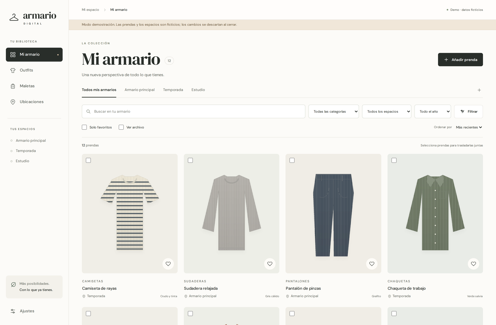

# Armario Digital

**Un catálogo visual para organizar prendas, crear outfits y preparar viajes.**

Aplicación local desarrollada con Python y SQLite. Los espacios son configurables, las fotografías permanecen en el dispositivo y la instalación empieza sin datos de ejemplo.

**Preview 0.2.0** · Python 3.11+ · Windows / Linux / macOS · Interfaz en español

[Primeros pasos](docs/GETTING_STARTED.md) · [Arquitectura](docs/ARCHITECTURE.md) · [Auditoría](docs/AUDIT.md) · [Comprobaciones](https://github.com/manuuelmarin/armario-digital/actions)



*Captura real de la aplicación. Todas las prendas, ilustraciones y ubicaciones de esta demo son ficticias.*

## Qué ofrece

- **Catálogo visual.** Hasta seis fotos por prenda, imágenes adaptadas a pantallas de alta densidad y vista ampliada. Marca, talla, color, temporada, compra y notas opcionales.
- **Organización flexible.** Espacios con nombres propios, búsqueda sin tildes, filtros combinables, ordenación, favoritos y archivo.
- **Outfits.** Combinaciones guardadas con búsqueda, filtro de favoritos, vista completa y duplicación; el selector visual permite consultar dónde están las prendas.
- **Maletas.** Listas que incorporan prendas y outfits sin duplicados, objetos adicionales, copia o vuelta y confirmación explícita de traslados. Se pueden imprimir o guardar como PDF desde el navegador.
- **Recuperación.** Copias consistentes de SQLite y fotografías, verificación de integridad y restauración offline con conservación del estado anterior.

El archivo conserva las relaciones entre prendas, outfits y viajes. Preparar una maleta no cambia la ubicación de las prendas.

## Empezar

### Windows

Requisito: [Python](https://www.python.org/downloads/) 3.11 o posterior, con el lanzador `py`. Python 3.12 es la versión de referencia de CI.

1. Clona el repositorio o descarga **Code → Download ZIP** y extrae la carpeta completa.
2. Ejecuta `instalar.cmd` una vez.
3. Abre `iniciar.cmd`.
4. Visita `http://127.0.0.1:8765` y crea tu primer espacio.

La instalación inicial descarga las dependencias. Después, el catálogo funciona sin conexión. Cierra el servidor con **Ctrl+C**.

### Linux y macOS

```bash
python3 -m venv .venv
. .venv/bin/activate
python -m pip install -r requirements.txt
python run.py
```

## Explorar la demo

```bash
python run.py --demo
```

El modo demo crea un inventario ficticio en una carpeta temporal aislada. Sus cambios se descartan al cerrar. No utiliza la carpeta del inventario habitual. Para ejecutarlo en otro puerto:

```bash
python run.py --demo --port 8766
```

## Desarrollo

```bash
python -m pip install -r requirements-dev.txt
python run.py --dev
python -m pytest -q
python -m ruff check .
python -m ruff format --check .
python -m djlint armario/templates --check
```

Las plantillas, CSS y JavaScript son editables directamente; el modo de desarrollo recarga los archivos al guardarlos. No hay compilación frontend ni despliegue obligatorio.

[Cómo ejecutar las pruebas de navegador](docs/TESTING.md) · [Guía de contribución](CONTRIBUTING.md)

## Datos y actualizaciones

Los datos se almacenan fuera del código: `%LOCALAPPDATA%\ArmarioDigital` en Windows y `~/.local/share/armario-digital` en sistemas Unix. `ARMARIO_DATA_DIR` y `--data-dir` permiten elegir otra carpeta.

Antes de actualizar, crea una copia desde Ajustes, cierra el proceso, actualiza el código y vuelve a instalar los requisitos. Las migraciones conservan los registros existentes y crean una copia previa al cambiar el esquema.

[Copias y restauración](docs/BACKUP_RESTORE.md) · [Modelo de datos](docs/DATA_MODEL.md)

## Alcance de esta versión

La versión 0.2 es una preview para uso local y monousuario. Están pendientes los tableros de inspiración, meteorología, colecciones y editor libre de collages. La compatibilidad de servidor se comprueba en Windows y Linux; el lanzador gráfico y la experiencia de instalación deben probarse en cada plataforma de distribución.

Publicar el código y ofrecer un servicio accesible por internet requieren revisiones diferentes. El proceso actual escucha únicamente en loopback y no incorpora cuentas ni controles multiusuario. La elección de licencia de distribución del código está pendiente.

[Preparar una publicación](docs/PUBLISHING.md) · [Seguridad](SECURITY.md) · [Changelog](CHANGELOG.md) · [Roadmap](docs/ROADMAP.md)
