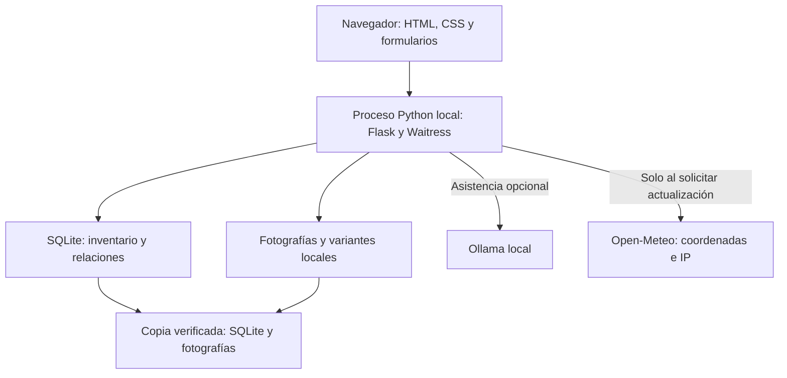

# Arquitectura

## Componentes

Un proceso Python sirve HTML y recursos locales, aplica las reglas del dominio y accede a SQLite. No hay una SPA ni una compilación frontend. Waitress es el servidor normal; el modo de desarrollo utiliza recarga de archivos sin depurador interactivo.

| Módulo | Responsabilidad |
|---|---|
| `run.py` | Lanzador, exclusión de instancias, modo demo y recuperación offline |
| `inventory.py`, `looks.py`, `trips.py`, `settings.py` | Rutas y flujos por funcionalidad |
| `organization.py` | Colecciones, etiquetas y asociaciones con prendas |
| `boards.py` | Tableros, enlaces y posiciones del collage local |
| `weather.py` | Consulta explícita a Open-Meteo y última previsión guardada |
| `assistant.py` | Rutas de configuración, revisión, cola y generación opcional |
| `ai_client.py`, `ai_jobs.py` | Contrato Ollama loopback y trabajador secuencial persistente |
| `profiles.py`, `recommendations.py` | Siete grupos revisados, vigencia, candidatos, restricciones y valoraciones |
| `domain.py` | Validaciones y operaciones compartidas |
| `queries.py` | Lecturas de prendas con su imagen principal y entidades permitidas |
| `db.py`, `migrations/` | Conexiones, integridad y evolución del esquema |
| `images.py` | Validación, orientación, recodificación y resoluciones |
| `backups.py` | Snapshots, manifiestos, verificación y restauración |
| `demo.py` | Colección ficticia e ilustraciones originales, sin datos reales |
| `templates/`, `static/` | Plantillas, estilos por responsabilidad, fuentes e interacciones progresivas |

## Persistencia y concurrencia

Las conexiones se abren por solicitud y siempre activan claves foráneas. Las escrituras adquieren un bloqueo común dentro del proceso y las operaciones relacionadas utilizan transacciones. El punto de entrada soportado es `run.py`, que además adquiere un bloqueo del sistema operativo para impedir procesos simultáneos sobre la carpeta.

La restauración se hace con el servidor cerrado. Las copias usan la API de backup de SQLite y las imágenes referenciadas por ese snapshot, con mutaciones excluidas durante el empaquetado.

## Interfaz y rendimiento

La galería pagina 48 prendas. La imagen principal se obtiene en la consulta de inventario. La biblioteca de outfits carga sus componentes en conjunto, evitando una consulta por combinación.

Las fotografías usan variantes de 512, 1.024 y hasta 4.096 px y atributos `srcset` y `sizes`. Las fotos anteriores mantienen una ruta de compatibilidad sin regeneración destructiva. Las imágenes y fuentes son locales; no se necesitan CDN. HTML y copias no se cachean; recursos estáticos e imágenes con nombres únicos tienen políticas de caché diferenciadas. En desarrollo se desactiva esa caché.

Los estilos se dividen en `tokens.css` (variables y fuentes), `app.css` (base y estructura), `components.css` (pantallas y componentes) y `responsive.css` (adaptación y accesibilidad). Las plantillas usan formato Jinja verificable con djLint.

JavaScript mejora selección masiva, filtros móviles, búsqueda en selectores, vista previa, galería y consulta de estado de tareas. Los formularios siguen siendo operativos sin JavaScript. El selector de outfits pagina visualmente en cliente y conserva selecciones; todavía renderiza el armario activo completo desde el servidor.

## Decisiones

Se comparó reutilizar Libre Closet, usar NiceGUI y separar frontend y API. Se eligió Flask + Jinja + SQLite por el alcance local, la edición directa de HTML/CSS y un único proceso sin compilación frontend. El coste aceptado es implementar y mantener capacidades que otras soluciones ofrecen ya, como el collage libre o una PWA.

No se han medido comparativamente esos frameworks ni se atribuyen garantías de rendimiento a alternativas no ejecutadas. Las referencias de producto están en [AUDIT.md](AUDIT.md).

## Contratos que deben conservarse

| Operación | Comportamiento esperado |
|---|---|
| Preparar una maleta | Cambia su lista; la ubicación solo cambia tras confirmar un traslado |
| Etiquetar o añadir a una colección | Añade asociaciones sin mover la prenda |
| Importar fotografías por lotes | Una prenda por imagen; un fallo revierte el lote y retira sus archivos nuevos |
| Guardar inspiración | Guarda imágenes locales y enlaces; no descarga el contenido de las URL |
| Actualizar el tiempo | Hace una petición solo al pulsar actualizar; un fallo conserva la previsión anterior |
| Crear una copia | Usa un snapshot y verifica las imágenes referenciadas y sus hashes persistidos |

La integridad de imágenes se registra desde el esquema 5. Una primera línea base no puede detectar una modificación anterior a su creación. El esquema 6 incorpora organización y el 7, tableros y caché meteorológica. Véanse [modelo](DATA_MODEL.md) y [recuperación](BACKUP_RESTORE.md).

## Límite de red

El catálogo no requiere red tras instalar dependencias. La meteorología es opcional y envía coordenadas e IP a Open-Meteo al actualizar; borrar su caché activa no elimina los datos de copias anteriores. Abrir un enlace de inspiración utiliza el navegador y el destino externo aplica sus propias condiciones. No hay sincronización del inventario ni geolocalización automática.

## Asistencia local opcional

La app no carga los pesos: un servicio Ollama preparado aparte atiende el endpoint fijo `127.0.0.1:11434`. Visión recibe una foto principal recodificada temporalmente y devuelve una propuesta de perfil. Solo la aprobación explícita escribe una revisión utilizable. Texto recibe resúmenes de perfiles aprobados y candidatos completos; Python aplica los filtros y verifica nuevamente el resultado antes de guardarlo. No hay llamadas cloud ni descargas de modelos desde el adaptador.

`run.py` inicia un único trabajador dentro del bloqueo de instancia. La cola reside en `ai_jobs`; cada operación abre y cierra su propia conexión. Las capturas y escrituras breves comparten `MUTATION_LOCK` con las solicitudes. La inferencia transcurre fuera de ese bloqueo y fuera de una transacción, de modo que no impide seguir usando el armario o crear copias. Antes de publicar un resultado se comprueban foto, hash, revisión, ubicación y disponibilidad. El cierre descarta respuestas tardías, y un arranque marca en error las tareas interrumpidas sin reintentar inferencias automáticamente.

El cliente usa JSON estructurado, límites de tamaño/contexto y `keep_alive=0`; el control de carga global se configura también en Ollama. La procedencia registra etiqueta/digest, esquema de perfil, versión de instrucciones, datos y resultado validado. Las restricciones, aproximaciones de preselección y límites de memoria/cancelación están en [LOCAL_AI.md](LOCAL_AI.md).
